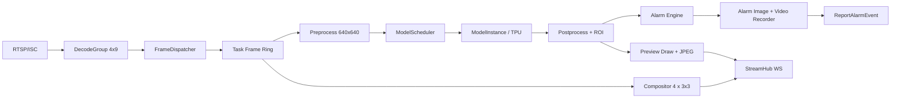

<!-- pm:meta
iteration: 5
updated: 2026-11-02
commit: -
-->

# 整体构建方案（C++ AI 检测服务端）

> 本文是「源码重构第一步」的技术路径方案，也是第二步（3）的整体构建方案。
> 输入：[INTERFACES.md](INTERFACES.md)、[SERVICE_TASKS.md](SERVICE_TASKS.md)、旧 Python 源码、需求文档、`reference/code/sophon-demo-release`。
> 迭代 5 已按本文落地 MVP+；与目标方案的剩余偏差集中在 §0.1，完整状态见 `PROGRESS.md`。

## 0.1 实现状态与偏差（迭代 5）

已落地：单进程、HTTP/WS 9000、JWT 验证、`/get_occupancy`、`/task/start|stop|list`、area frame、真实后端配置、RTSP/ISC/本地解码、5 类模型 + 反光衣 FP16 推理、多实例调度、10fps 可配预览、4 组×9 槽硬件合流、告警图 + 5+5 视频 + 上报、Docker/Compose。

剩余偏差：

| 目标 | 当前现状 | 影响 |
|---|---|---|
| 4 个 `MultiDecoder` 组 ×9 | `AIDETECT_DECODE_MODE=multi` 启用；默认 `single` | 36×1080（640 预览）36 running/stop；本地 640 告警视频 1.07 MB，RTSP multi 仍失败 |
| `ModelScheduler` 多实例 | 按 busy 扩容 + 空闲回收（默认 120s） | 36 路 2 实例；测试 2→1 |
| 6 个模型注册表 | 5 类 + 反光衣天空已接；救生衣参考视频 `2/4/1` | 真实场景更多样本可补 |
| 告警 5+5 视频 | RTSP H.264/H.265 已验证 | mpeg4 本地文件不支持 |
| async Beast 4 I/O 线程 | 线程/连接同步 Beast | 多 WS 客户端线程偏多 |
| 硬件合流 | `bmcv` decode/resize/copy/encode | 36 路 1080p/10fps 未证 |
| ISC | 协议/mock + .25 代理已验证 | 25K/三亚/博物馆真实出图；八所待查 |

这些偏差记录在 ADR-013..020 和 KI-006..019；不是“已经完成 36×1080p/10fps”。

## 1. 目标、约束与非目标

### 目标

- 一个可在 BM1684X 盒子长期稳定运行的 C++ 服务端，替代旧 Python 多进程方案。
- 支持 36 路任务通道 + 4 路 3×3 合流，接口与旧前端/后端兼容。
- 模型与任务解耦：同模型多任务共享实例；过载时按策略扩容同权重实例；空闲回收。
- 输出给前端的检测流 ≤10 fps；告警图片带框/中文，告警视频前后各约 5 秒。
- Docker 部署，容器内可访问 TPU/JPU/VPU。

### 约束

- 盒子：BM1684X SoC，aarch64，Ubuntu 20.04，8 核，6.1 GiB 内存；根分区约 2.8 GiB 可用，`/data` 约 45 GiB。
- 本轮模型：**FP16**；INT8 暂停（KI-001）。反光衣 FP16 权重已更新为 `yolov11s_fp16_1b_back_reflectivejacket_1.bmodel`。
- 旧接口必须尽量保持；旧实现里的配置字段/路径/WS 格式存在不一致，需按 `INTERFACES.md` 第 6 节逐项确认。
- 盒子不能访问外网；Docker 构建需离线/预置依赖方案。

### 非目标（本阶段不做）

- 不实现 INT8 量化/重导；不追 36 路全 25 fps 检测。
- 不重写前端/后端；任务/通道 CRUD、告警列表仍由后端负责。
- 不做模型训练；不改模型精度。
- 第一版不做跨机集群/多盒子调度。

## 2. 核心结论（先看这 8 条）

1. **单 C++ 服务进程，多线程流水线**，不再一任务一进程。这样模型、帧、检测结果都在同一地址空间，避免旧方案跨进程传图/传模型的开销（ADR-007）。
2. **4 个解码/合流组，每组 9 路**，与 4 路合流一一对应；任务通过稳定 hash 映射到 `(group, slot)`，合流位置固定（ADR-008/ADR-011）。
3. **共享模型调度器**：每种模型一个注册表项，下面 1~N 个 `ModelInstance`；任务提交推理请求，调度器按优先级/队列/实例容量分发；同模型多任务共享，过载扩容，空闲回收。
4. **FP16 only**：反光衣用新 FP16 权重，输入 `/255`；DamoYOLO 用 0-255；归一化作为模型元数据，不再硬编码（ADR-009）。
5. **控制面**：Boost.Beast（HTTP + WebSocket）+ `nlohmann/json` + OpenSSL HMAC（JWT HS256）；不引入 Drogon/Crow 等重框架（ADR-010）。
6. **数据面**：硬件解码 → 共享帧池 → 640×640 预处理 → 模型队列 → 后处理/ROI → 告警状态机/预览；只在输出时做一次 JPEG 编码。
7. **合流**：组内 9 路固定槽位，直接拼 3×3 1920×1080，再 JPEG 编码；不再“每路 JPEG→聚合解码→再编码”（旧 OLD-06）。
8. **告警**：每任务/模型一个滑动窗口 + 冷却；触发时抓带框图，视频用 `sail::Decoder::dump(5,5)`（或等价硬件录制）后转存；上报失败进本地待上报队列。

## 3. 进程与线程模型

### 3.1 单进程

```text
aidetect (1 个进程)
├─ Control/HTTP/WS 线程池（Boost.Asio，4 线程）
├─ TaskSupervisor（1 线程，1s tick）
├─ DecodeGroup[4]（每组 1 线程，sail::MultiDecoder 16 通道，9 路在用）
├─ FrameDispatcher（1 线程，按任务帧率/检测节奏分发）
├─ PreprocessPool（4 线程，letterbox/resize/ROI 坐标）
├─ ModelScheduler（每种模型 1 个调度线程 + N 个 ModelInstance 线程）
├─ AlarmWorkerPool（2-4 线程：抓图、视频收尾、上报）
├─ Compositor[4]（每组 1 线程，10 fps，3×3）
├─ Metrics（1 线程，1s）
├─ StorageGC（1 线程，30s）
└─ Watchdog（1 线程，5s）
```

- 线程总数目标 ≤ 45；不再出现 200+ Python 线程。
- 单进程的代价：一个未捕获异常可能影响全部任务。缓解：
  - 所有线程入口 `try/catch`，异常只让该任务/模型实例进入 `error`，由 Supervisor 重建；
  - 关键共享对象用 `shared_ptr` + 不可变快照；
  - Docker/systemd `restart: always` 兜底；
  - 后续若需要更强隔离，可把 4 个 DecodeGroup 拆成 4 个进程，但会牺牲模型共享，暂不做（ADR-007）。

### 3.2 线程与队列

| 队列 | 生产者 | 消费者 | 策略 |
|---|---|---|---|
| `decode_q[group]` | DecodeGroup | FrameDispatcher | 每通道只保留最新；满则丢旧 |
| `task_frame_ring[task]` | FrameDispatcher | 模型请求/预览 | 环形，保留最近 10~25 帧（按 FPS） |
| `infer_q[model][priority]` | 任务/告警 | ModelInstance | 3 级优先级；满则丢低优先级 |
| `result_cb` | ModelInstance | 任务线程（回调） | 结果带回 task/frame id；任务侧只保留最新 |
| `preview_q[task]` | 任务线程 | StreamHub | maxsize=1；只保留最新 JPEG |
| `composite_q[group]` | 任务线程 | Compositor | maxsize=1；只保留最新 frame |
| `alarm_jobs` | 告警状态机 | AlarmWorkerPool | 有界；满则丢弃并记日志 |

## 4. 数据流



1. `ControlService` 收到 `/task/start`，创建 `TaskContext`，分配 `(group, slot)`，拉配置（或复用配置缓存）。
2. `DecodeGroup` 用 `sail::MultiDecoder(16, 0, 1)` 打开该组 9 路；每路一个 channel；断流重连。
3. 解码帧进入 `FrameDispatcher`；按任务策略决定：
   - 预览：最多 10 fps；
   - 常态检测：默认 1 fps（可配 `frame_interval_detect`）；
   - 告警/目标活跃：短时升到源帧率（受模型调度准入控制）。
4. `Preprocess` 做 letterbox 到 640×640、RGB planar；保留原图坐标映射 `ratio/txy`；ROI 坐标随任务配置缓存。
5. `ModelScheduler.submit(model, frame, priority)`；`ModelInstance` 用 `sail::Engine::process`；输出 → 解码/NMS（YOLO11 单输出；Damo 多输出）。
6. 后处理按模型注册表的 `input_scale`/`class_names`/`target_id` 解析；ROI 过滤；得到 `Detection[]`。
7. `AlarmEngine` 更新滑动窗口；满足 `detect_section/detect_threshold` 且冷却通过 → 生成 `AlarmJob`。
8. 预览：任务线程用最新 `Detection[]` 画框/ROI/中文，`bmcv.imencode(".jpg")` → `StreamHub` 按 10 fps 发给订阅该 taskId 的 WS 客户端。
9. 合流：组内 9 个槽位各取最新预览帧（或 device 图），拼 3×3 → 1920×1080 → JPEG → `all_i` 10 fps。
10. 告警：抓当前帧画带框图；视频录制前后 5 秒；`ReportAlarmEvent` 上报；失败进待上报队列。

## 5. 模型管理与调度（核心）

### 5.1 注册表

```cpp
struct ModelSpec {
  std::string name;              // person/safetyhelmet/...
  std::string bmodel_path;       // 绝对路径
  std::vector<std::string> class_names;
  int target_id;
  std::string report_content;
  float input_scale;             // Damo 1.0(0-255), YOLO11 1/255
  int input_w, input_h;          // 640x640
  int max_instances;             // 例如 2-4
  float target_latency_ms;       // 观测值，初始 8ms
};
```

- 反光衣：`yolov11s_fp16_1b_back_reflectivejacket_1.bmodel`，`input_scale=1/255`，`class_names={"穿反光衣","未穿反光衣"}`，`target_id=1`。
- 其余 5 个：DamoYOLO FP16，`input_scale=1.0`。
- 注册表从配置文件/环境变量加载，不把权重路径硬编码在源码。

### 5.2 实例

- 一个 `ModelInstance` = 1 个 `sail::Engine` + 1 个工作线程 + 1 个输入/输出 Tensor 缓存。
- **同一个 Engine 不能被多线程并发 `process`**；实例内串行，实例间并行/分时。
- 每个实例维护：
  - 3 个优先级队列（P0 告警确认/告警帧，P1 常态 1fps，P2 低优先/预取）；
  - 在飞请求数、最近 100 次延迟 p50/p95；
  - 空闲时间、加载时间。
- 实例创建是异步的：`ModelScheduler` 先返回 `pending`，任务侧不阻塞解码；加载完成后重试或丢弃旧帧。

### 5.3 调度策略

1. **共享优先**：同模型所有任务先走已有实例；按“最少在飞请求 + 轮询”选实例。
2. **扩容**：某模型 P1 队列等待 p95 > `expand_wait_ms`（建议 15ms）且实例数 < `max_instances` → 异步加一个同权重实例；扩容冷却 10s。
3. **缩容**：实例空闲 > 30s 且同模型实例数 >1 → 停止并释放；保留至少 1 个热实例。
4. **准入控制**：
   - 每任务每模型最多 1 个在飞请求；新帧到来时旧结果未回则丢旧帧（保持最新）。
   - 每模型总在飞 ≤ `instances * 2`；超过则 P1/P2 直接丢帧，P0 保留。
   - 36 路常态 1fps 只占约 0.19 s/s TPU；burst 全速按“同时最多 4 路”配额，超过排队/降频。
5. **优先级**：P0（已触发告警的确认帧/抓图）> P1（常态检测）> P2（预取/低价值）。P0 不被 P1 饿死；同优先级 FIFO。
6. **批量**：第一版 batch=1；若后续换 4b 模型，可按 `batch_size` 聚合同模型请求，但会引入延迟，需单独 ADR。

### 5.4 实例数估算

```text
N = ceil(required_fps * latency_s / target_util)
target_util = 0.7
```

- 36 路 × 1fps，单模型约 6 路 → 6 fps × 0.0052 s ≈ 0.031 → 1 个实例足够。
- 4 路 burst 25fps + 32 路 1fps：约 132 fps × 0.0052 ≈ 0.69 s/s → 接近 1 个 TPU 的 70%，需要 1~2 个实例/调度限流。
- 8 路 burst：约 232 fps × 0.0052 ≈ 1.2 s/s → 超过单 TPU，必须限流或加实例（实例共享同一 TPU，不会增加算力，只减少排队/提高利用率）。
- 结论：**实例数不是越多越好**；上限由 TPU 总算力决定。`max_instances` 建议 2（YOLO11）/2（Damo），主要目的是隔离长尾/排队，不是线性扩容。

## 6. 任务、通道与合流

### 6.1 TaskContext

```text
id, state, config_snapshot, group(0..3), slot(0..8),
decoder_channel, latest_frame, latest_dets[model],
alarm_state[model], latest_preview_jpeg,
metrics, last_error, start_time
```

状态：`stopped → starting → running → stopping → stopped`；异常 `error`。所有状态变更走 `TaskSupervisor`，HTTP 线程不直接操作 decoder。

### 6.2 映射

- `group = stable_hash(taskId) % 4`，`slot = (stable_hash(taskId) / 4) % 9`；冲突线性探测；9 个槽满则任务进入 `pending` 并返回明确错误。
- 同一组 9 路对应 `all_<group+1>`（`all_1..all_4`）；任务通道 id 仍为 taskId。
- 旧实现按端口顺序分配，任务少时合流不均；新实现固定槽位，预览页 3×3 位置稳定。

### 6.3 10 fps 限流

- 每任务一个 token bucket：容量 1，速率 10/s；预览线程取到 token 才编码/发送；否则丢弃该帧。
- 合流每 100ms 一次；没有新帧的槽位保留上一帧或黑底“任务未配置”。
- 原始流 <10fps 时自然跟随，不补帧。

## 7. 告警设计

### 7.1 状态机

每个 `(task, model)`：

- 滑动窗口 `deque(maxlen=detect_section)` 存 `bool target_detected`；
- 每帧计算 `report_num = count(detection.class_id == target_id && ROI)`；
- `target_detected = report_num >= exceed_num`；
- 触发：`sum(window) >= detect_threshold && now - last_report >= cooldown_time && target_detected`；
- 触发后 `last_report = now`，生成 `AlarmJob`；窗口不清空（避免重复触发由冷却控制）。

> 旧实现硬编码 `maxlen=10`、`sum>=6`、每 5 帧；新实现全部取配置（OLD-03）。

### 7.2 证据

- 图片：触发帧的原图（1920×1080 或源分辨率）→ 画 target 红框 + 中文类别/置信度 + ROI 蓝线 → JPEG。
- 视频：启动时 `decoder.enable_dump(video_duration + 2)`；触发时 `sail::Decoder::dump(5, 5, tmp_path)`（或等价硬件录制），随后 `ffmpeg -c copy` 转存到 `/data/CT/project/ai/inference/save/<taskId>/<model>/video/`；不能用 CPU 逐帧转码。
- 文件名：`YYYYmmdd_HHMMSS.jpg/mp4`；目录 `/data/CT/project/ai/inference/save/<taskId>/<model>/img|video`。
- 上报：`ReportAlarmEvent`，JWT，5s 超时；失败重试 3 次（指数退避），仍失败写本地 `pending_reports`。
- 磁盘：`StorageGC` 按天数/容量清理 `/data/CT/project/ai/inference/save/`；默认保留 7 天或 20 GiB，可配置。

### 7.3 视频录制风险

- `Decoder::dump` 的行为/阻塞时间需在 M5 实测；旧代码在视频线程里同步调用，可能造成解码停顿。
- 备选：每任务一个 2 秒分段的硬件 Encoder 环形缓冲，触发时拼接；代价是持续编码开销。第一版优先 `dump`，实测后再选。

## 8. 控制面与接口实现

### 8.1 HTTP/WS

- Boost.Beast + Asio：一个 `io_context`，4 个 I/O 线程；HTTP 路由：
  - `GET /get_occupancy`
  - `POST /task/start`、`POST /task/stop`、`GET /task/list`
  - `GET /task/get_area_frame`
  - `WS /ws/frame`
- **不提供** `/get_token`、`/refresh_token`；token 由前端/后端签发，AI 只验证。
- 所有 handler 只做参数校验/入队，耗时操作投递到 TaskSupervisor/AlarmWorker，避免阻塞 I/O。
- JSON：`nlohmann/json`；JWT：OpenSSL HMAC-SHA256 + Base64URL（或 vendor `jwt-cpp`）。
- CORS：可配置；默认允许同源/内网。
- 端口：HTTP 9000，WS 9000 `/ws/frame`；合流 id `all_1..all_4`。
- `/task/start` 保留 `pid` 字段，值用服务进程 PID（单进程没有每任务 PID；前端只用 status/msg）。

### 8.2 认证

- `JWT_SECRET` 从 `AIDETECT_JWT_SECRET` 或只读文件读取；启动时缺失则拒绝启动。
- 入站只做验证：兼容 `user_id` 与 .NET 长 claim；iss/aud/exp 严格校验。
- 出站调后端时用 `create_jwt("admin")` 自己签 token；不需要用户库，不需要 `/get_token`。

### 8.3 后端客户端

- `BackendClient`：配置 GET、告警 POST；连接池/超时/重试；URL 可配置（默认 `http://10.10.206.25`）。
- 配置轮询：每 5s；ETag/版本号可选；diff 后热更新模型/ROI/阈值；失败退避（1s/2s/5s/10s，最大 30s），不阻塞任务启动。
- 告警上报：异步队列；失败落盘；启动时重放。

### 8.4 资源指标

- CPU：读 `/proc/stat` 两次采样；内存：`/proc/meminfo`；磁盘：`statvfs("/data")`。
- TPU/VPU/VPP：`sail::get_tpu_util` / `get_vpu_util` / `get_vpp_util`；设备内存：`sail::get_dev_stat`。
- 温度：`sail::get_chip_temp` / `get_board_temp`，失败回退 `/sys/class/thermal`。
- 返回字段按 `INTERFACES.md` 2.1：`vpu_1..3`、`vpp_1..2`（没有 `vpp_3`）。

## 9. 目录结构与构建

```text
gh-aibox-dev/
  CMakeLists.txt
  src/
    main.cpp
    app/            # HTTP/WS、路由、鉴权
    auth/           # JWT 验证 + 出站 create_jwt
    config/         # 环境变量、模型注册表、任务配置
    task/           # TaskContext、Supervisor、状态机
    video/          # DecodeGroup、FramePool、Preprocess
    model/          # ModelSpec、ModelInstance、ModelScheduler
    infer/          # YOLO11/Damo 后处理、NMS、ROI
    alarm/          # AlarmEngine、Evidence、VideoRecorder、Reporter
    aggregate/      # Compositor 4x3x3
    stream/         # StreamHub、WS 订阅/封包
    metrics/        # occupancy、watchdog
    storage/        # save 路径、GC、待上报
    util/           # 日志、时间、UUID、线程池
  tests/
    unit/           # JWT、配置、告警、调度
    integration/    # mock 后端 + 本地视频
  docker/
    Dockerfile
    docker-compose.yml
  docs/
```

- CMake：C++17（服务端新代码；官方 demo 保持 C++14 不动）。
- 依赖：sail/libsophon/mw（已有 SDK）、OpenCV/FFmpeg（SDK）、Boost 1.71（系统已有）、OpenSSL 1.1（系统已有）、nlohmann/json（vendored single header）。
- 构建：`cmake -S . -B build -DCMAKE_BUILD_TYPE=Release`；`cmake --build build -j8`。
- 测试：`ctest --test-dir build`；集成脚本 `tests/integration/run.sh`。

## 10. Docker 部署

### 镜像

- 多阶段：
  - builder：`ubuntu:20.04`（aarch64）+ `build-essential cmake libboost-all-dev libssl-dev`，编译服务；
  - runtime：`ubuntu:20.04` + 运行库（Boost/OpenSSL 运行包）+ 从 `env/sdk` 复制 libsophon/mw/sail + 服务二进制。
- 模型不放进镜像：`/models` 挂载宿主机 `/data/CT/project/ai/models`；`/data` 挂载告警存储。
- 设备：`/dev/bmdev-ctl`、`/dev/bm-tpu0`、`/dev/bm-vpp`、`/dev/bm-tach-0`、`/dev/jpu`、`/dev/vpu` 等；必要时 `privileged: true`。
- 网络：`network_mode: host`（后端/RTSP/前端都在内网），端口 9000。
- 环境变量：`AIDETECT_JWT_SECRET`、`BACKEND_BASE_URL`、`MODEL_ROOT`、`DATA_ROOT`（默认 `/data/CT/project/ai/inference/save`）、`HTTP_PORT`、`WS_PORT`、`LOG_LEVEL`。
- 健康检查：`GET /get_occupancy` 或 `/health`（新增，需前端允许）。
- 离线：盒子无外网，Docker 镜像需在可联网机器构建后 `docker save/load`，或把 `.deb`/依赖预置到构建上下文；Dockerfile 不在构建时 `apt-get update`（可用 `--network=none` 验证）。

## 11. 性能预算与容量

| 项 | 数值 | 来源/说明 |
|---|---|---|
| FP16 YOLOv11 推理 | 5.214 ms/帧 | 官方 demo 实测（3 图平均） |
| 预处理 | 1.668 ms/帧 | 同上 |
| 后处理 | 0.245 ms/帧 | 同上 |
| 单路 1080p 解码 | ~241 fps（burst） | `sail.Decoder` 短片段 |
| 36 路 × 1 fps 常态 | 0.19 s/s TPU | 36×5.214ms |
| 4 路 × 25 fps burst | 0.52 s/s TPU | 100×5.214ms |
| 8 路 × 25 fps burst | 1.04 s/s | 超过单 TPU，必须限流 |
| 合流 | 4×10 fps 1080p JPEG | 需 M4 实测编码开销 |
| 预览 | 36×10 fps JPEG | 需 M4 实测带宽/编码 |
| 内存 | 6.1 GiB；模型权重 ~0.33 GiB + 实例/帧池 | 需 M3/M7 实测 |

结论：**36 路常态 1fps + 少量 burst 可行；36 路全 25fps 检测不可行**。调度器必须做准入控制和 burst 配额，不能把所有帧都塞进模型队列。

## 12. 里程碑

| 里程碑 | 内容 | 验收 |
|---|---|---|
| M1 | 工程骨架、HTTP/WS、JWT、occupancy | 接口 mock 测试通过 |
| M2 | TaskContext/配置/start/stop/area frame | 单任务本地视频跑通 |
| M3 | 模型注册表/调度器/FP16 反光衣 | 多任务共享一个模型实例；新权重 14 框复现 |
| M4 | 预览/合流 4×9/10fps | 4 组合流稳定，槽位固定 |
| M5 | 告警状态机/图片/5+5 视频/上报 | 本地 mock 后端收到正确 JSON/文件 |
| M6 | Docker | 容器内 M2-M5 通过 |
| M7 | 36 路压测/长稳 | 30 分钟不掉帧、内存增长 <5% |

## 13. 风险与待确认

| 风险 | 影响 | 缓解 |
|---|---|---|
| `frameInterval`/`cooldownTime` 单位 | 告警节奏偏差 | 用真实后端 fixture 对齐；旧实现 `*60` 转秒 |
| `Decoder::dump` 阻塞/精度 | 告警视频偏移/卡顿 | M5 实测；备选 Encoder 环形缓冲 |
| 36 路解码/编码 | 掉帧/CPU 满 | 4 组 MultiDecoder；实测 VPU；输出限 10fps |
| Docker 设备权限/离线构建 | 镜像起不来 | `privileged` + 预置依赖 + 设备清单 |
| FP16 只支持 36 路常态 | burst 能力有限 | 准入控制/配额；后续评估 INT8 |
| `/task/start` 的 `pid` 语义 | 前端若用 pid 做进程控制会失效 | 单进程返回服务 PID；确认前端只用 status/msg |
| 旧配置字段语义 | 行为偏差 | 用真实后端 fixture 对齐；保留兼容层 |

## 14. 本轮已完成的验证

- 新 FP16 权重 `yolov11s_fp16_1b_back_reflectivejacket_1.bmodel`：md5 `13d8...`，输入 `1×3×640×640`，输出 `1×6×8400`。
- `probe_model.py`：`norm=255` → `class_max=0.913574`、62 个 anchor >0.25；`norm=1` → 534 个（误检），确认必须 `/255`。
- 官方 C++ demo：3 张图 14 个框（11 vest / 3 no_vest），inference 5.214 ms，视觉框正确。
- 旧源码逐文件盘点：接口、线程/进程、配置字段、告警/合流缺陷见 `INTERFACES.md`、`SERVICE_TASKS.md`。
- 依据：`docs/assets/new_fp16_probe.txt`、`step2_verify.log`、`step2_result.json`、`step2_yolov11_detection.jpg`、`perf_baseline.txt`。

## 15. 迭代 4 实现验证（MVP）

- `cmake --build build/aidetect -j8` → `BUILD_OK`；`src/` 单进程服务可启动。
- 真实任务 `6488...`：start `status=ok,pid=<服务PID>`，area frame 533 KB，WS 任务通道 533 KB，`all_3` 合流 140 KB；stop 后 `running=[]`。
- 本地反光衣视频：`detections=7`，`ALARM count=3`，告警图 461 KB，`alarm reported` 成功；`video` 空（KI-007）。
- Docker：`aidetect:dev` 901 MB；容器内模型加载、任务启动、area/WS 通过；基于 `aibox-api:latest` + OpenSSL 1.1（ADR-015）。
- 视觉证据：`docs/assets/service_preview.jpg`、`service_alarm.jpg`、`service_aggregate.jpg`、`docker_area.jpg`、`docker_ws.jpg`。

## 16. 迭代 5 实现验证（MVP+）

- 5 模型：Damo 安全帽 7~9、人员 3~6、抽烟 1（conf 0.1）；救生衣模型加载但样本未检出；真实 RTSP 任务同时跑反光衣+安全帽。
- 告警视频：RTSP `dump(5,5)` + 继续读 post 秒，生成 9.64s/2560×1440/H.264/1.44MB；后端 `videoPath` 验证。
- ISC：本地 HTTPS mock 验签 `sig_ok=True`，解析 RTSP 后 area 542,296 字节；真实 `10.10.69.250:443` refused。
- 36 路：36 任务 running，30s，RSS 375MB，CPU 331%，TPU 24%，2 个模型实例；`all_1..4` 均 1920×1080 JPEG（约 676KB）。
- 硬件合流：`bmcv.imdecode/resize/image_copy_to/imencode`，3×3 正确。
- Docker/Compose：镜像 901MB；Compose v2.29.7 `config/up/ps`，Compose 任务 area 542,152 字节。
- 视觉证据：`docs/assets/damo_safetyhelmet.jpg`、`service_aggregate.jpg`、`alarm_video_frame.jpg`。
