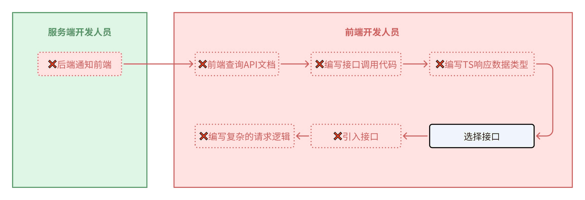
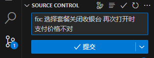
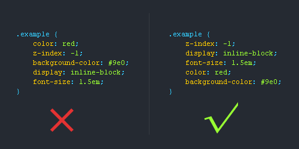

<div align="center">

</div>

## 基于nova-admin二次开发

- [Nova-Admin 预览](https://nova-admin-site.netlify.app/)
- [Nova-Admin 文档](https://nova-admin-docs.netlify.app/)

## 特性

- 基于Vue3、Vite5、TypeScript、NaiveUI、Unocss等最新技术栈开发
- 基于axios封装和配置，提供统一的响应处理和多场景能力
- 完善的前后端权限管理方案
- 支持本地静态路由和后台返回动态路由，路由简单易配置
- 对日常使用频率较高的组件二次封装,满足基础工作需求
- 黑暗主题适配, 界面样式保持Naive风格
- 仅在提交时进行eslint校验，没有过多限制，开发更简便
- 界面样式布局灵活可配置

### 🧩 功能模块

项目包含以下功能模块，每个模块都有独立的路由：

- **首页** (`/index`) - AI盒子数据大屏展示
- **通道管理** (`/channel-management`) - 管理系统通道配置
- **任务管理** (`/task-management`) - 监控和管理系统任务
- **实时预览** (`/real-time-preview`) - 实时监控系统状态
- **告警预览** (`/alarm-preview`) - 查看系统告警信息
- **参数配置** (`/parameter-config`) - 系统参数设置
- **其他配置** (`/other-config`) - 其他配置选项

## nodejs版本

V18.20.3及以上，推荐使用18.20.3版本

## 安装流程

```js
// 安装
pnpm i

// 本地启动
pnpm dev

// * 本地启动时，检查环境变量VITE_HTTP_PROXY是否为Y，通常需要设置为Y，表示开启代理

// 打包
pnpm zip

// * 命令执行后，会在根目录下生成一个archive目录，生成的zip文件就在其中

```

## nvm 管理多版本 nodejs

> nvm 是一个 Node.js 版本管理器 ，为了解决 node 各种版本存在不兼容问题，nvm 其实是让你在同一台机器上根据需要，安装 或 切换项目所对应的 node 版本来适配项目。

- 基础用法

```js
// 查看列表
nvm ls

// 安装指定版本
nvm install [version]
// nvm install 16.0.0

// 卸载指定版本
nvm uninstall [version]
// nvm uninstall 16.0.0

// 查看当前版本号
$ nvm current
// v14.15.0

// 使用指定版本
nvm use [version]
// nvm use 16.0.0
```

- 注意，如果你的项目当中并不需要使用到船讯网的地图，请将index.html当中的两个外部js引用删掉。

```js
/* <script src="https://api.shipxy.com/h5s/api/3.5/plugins/jquery/jquery.min.js"></script>
<script src="https://api.shipxy.com/h5s/api/3.5/?k=%VITE_SHIPXY_KEY%"></script> */
```

## 适配

- 基于autofit.js使用scale适配，naiveUI转为rem，需注意n-select需要关闭虚拟滚动，否则无法显示
- 偏移值处理使用autofit - ignore
- 高德地图开启3D模式处理因缩放造成的经纬度偏移

## 生成 request 请求代码

传统的方式去编写request请求代码过于繁琐，如下图：


- 现在直接使用@umijs/openapi生成 request 请求代码

[在线@umijs/openapi文档](https://www.npmjs.com/package/@umijs/openapi)

步骤：
1、在scripts/api.js文件当中修改schemaPath
2、命令行执行pnpm api

完成以上两步，便能在src/service目录下面看到生成的request 请求代码文件

## http代理

- 通常由于后端没有配置跨域响应头，在前端发起请求后，浏览器控制台会报一个COS错误，这是由于客户端浏览器的同源策略所致。此时，我们只需要开启代理，在.env.dev文件当中设置VITE_HTTP_PROXY=Y即可。

- http代理的本质就是在客户端浏览器和服务端之间架设了一个中间层，所以在开发环境中，客户端浏览器实际访问的是这个中间件服务，中间件服务向后端发起请求获得数据后返回给客户端浏览器，
  从而实现跨域访问。

## 目录及文件命名

目录命名统一采用短横线(kebab-case)风格，组件命名采用大写驼峰式(CamelCased)，其他ts文件采用小写驼峰式(camelCased)。

例如：
/src/views/index/IndexView.vue
/src/views/user-center/IndexView.vue
/hooks/useShipxy.ts

## 异步函数

```js
// 推荐使用tryit函数包裹异步函数

async function getTree() {
  loading.value = true
  const [error, r1] = await utils.tryit(api.tide.getTideTideTreeList)()
  loading.value = false

  if (error || !r1?.data)
    return
  tree.value = JSON.parse(JSON.stringify(r1.data))
}
```

## 路由权限指令

```html
<n-h2>v-permission 指令用法</n-h2>
<n-spce>
  <n-button v-permission="'super'"> 仅super可见 </n-button>
  <n-button v-permission="['admin']"> admin可见 </n-button>
</n-spce>

```

## 关于 SVG 的使用

1. 直接使用svg

```vue
<script setup>
import SvgTideOnline from '@/assets/svg-icons/tide_online.svg'

// 或者
const SvgTideOnline = new URL('@/assets/svg-icons/tide_online.svg', import.meta.url).href
</script>

<template>
  

  <svg-icons-cool class="text-2em" />

  <icon-park-outline-apple />
</template>

```

2. 作为组件使用

```vue
<template>
  <nova-icon icon="eva-color-palette-outline" />
</template>
```

## 基础组件

- 更多用法，请自行探索 https://icon-sets.iconify.design/*

## 关于 TS 书写规范

全局 ts 文件位于 src/typings 目录下，其中包括 dto.d.ts、vo.d.ts、global.d.ts，DTO 对象下编写接口出参的所有字段类型，VO 对象下编写界面上所需用到的接口出参字段类型，
但这两个文件同时存在，这是有必要的，看似关联，实则无关。

## 优化

优化包含的面比较广，这里我们主要强调组件的优化。建议在编写组件的过程当中，时刻考虑UI与逻辑的解耦，这里我们推荐使用hooks，组件的拆分则关注是否职责单一。

## 代码提交规则

"feat", // 增加新功能
"fix", // 修复 bug
"add", // 增加代码逻辑
"del", // 删除功能
"update", // 更新功能
"docs", // 文档相关的改动
"style", // 不影响代码逻辑的改动，例如修改空格，缩进等
"build", // 构造工具或者相关依赖的改动
"refactor", // 代码重构
"revert", // 撤销，版本回退
"test", // 添加或修改测试
"perf", // 提高性能的改动
"chore", // 修改 src 或者 test 的其余修改，例如构建过程或辅助工具的变动
"ci", // CI 配置，脚本文件等改动



## CSS 书写规范

1、定位属性：position display float left top right bottom overflow clear z-index
2、自身属性：width height padding border margin background
3、文字样式：font-family font-size font-style font-weight font-varient color
4、文本属性：text-align vertical-align text-wrap text-transform text-indent text-decoration letter-spacing word-spacing white-space text-overflow
5、css3 中新增属性：content box-shadow border-radius transform……
按照上述 1 2 3 4 5 的顺序进行书写。



## 阿里云数据可视化平台

http://datav.aliyun.com/portal/school/atlas/area_selector
